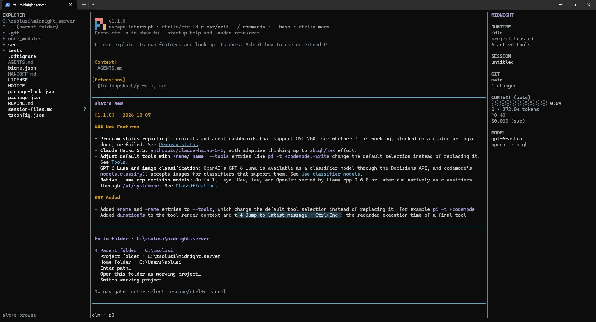

# midnight.server

A native **Pi suite** with context management, safe checkpoints/rewind, session sidebar and file explorer, a blue theme, compact tool output, automatic titles, token-speed stats, clarification questions and a local evidence ledger. Local log triage is included; browser access and chat-helper uploads are explicit opt-in integrations. No separate pi-clm or pi-rewind installation is needed.

Requires **Pi 1.2.0** (matching the current managed Pi installation), **Node.js 22.19+**, and Git on PATH. Side panels need fullscreen mode. There is no build step or standalone server. Core services use the pinned Pi libraries; the browser server is an optional npm dependency.

[**v0.5.0-beta.1**](https://github.com/soliluqoy/midnight.server/releases/tag/v0.5.0-beta.1) is the native-suite **prerelease**, not a stable release. Fullscreen interaction and an isolated fresh installation remain unverified release gates; see the [release notes](docs/releases/v0.5.0-beta.1.md). [v0.4.0](https://github.com/soliluqoy/midnight.server/releases/tag/v0.4.0) remains the previous stable release and predates these native additions. Midnight is Pi-only; Claude Code and Codex CLI integrations are not included.



## Install

Install the published native-suite prerelease with a pinned tag:

```powershell
pi install git:github.com/soliluqoy/midnight.server@v0.5.0-beta.1
```

That published tag still includes the older ScaleDown integration; it does **not** include the newer local-first chat-model triage or helper picker described below. To try those changes from the development branch instead:

```powershell
pi install git:github.com/soliluqoy/midnight.server@main
```

`main` is a moving development branch, not a pinned release. Installing the same repository with a different ref replaces its Pi package declaration; check `pi list` and keep only one Midnight source. Updating a tag-pinned install does not move it to a newer tag or to `main`.

Restart Pi or run `/reload`, then choose fullscreen TUI mode in `/settings`. Source archives, a packaged `.tgz`, and checksums for the published prerelease are available from [GitHub Releases](https://github.com/soliluqoy/midnight.server/releases).

To try a local checkout:

```powershell
git clone https://github.com/soliluqoy/midnight.server.git
cd midnight.server
pi --extension . --tui-mode fullscreen
```

**Load only one Midnight source.** For local development, use the checkout instead of the Git-installed copy. Check `pi list`; duplicate copies compete for panels and shortcuts.

## Native ownership and migration

A fresh single-package installation enables native context management and Git checkpoints automatically. Existing panel, title, question and evidence behavior is preserved. Local log triage needs no helper key; optional chat-helper uploads require model selection and explicit consent. Browser access requires an explicit connection.

**Do not run two context or rewind engines.** At session startup Midnight checks public runtime command/tool registration. If external CLM/live-context or rewind ownership is detected, the overlapping native service pauses and `/midnight status` explains why. Canonical `/midnight-context`, `/midnight-context-compact` and `/midnight-rewind` controls remain diagnostic/guarded; familiar `/clm`, `/clm-compact` and `/rewind` aliases are registered only when native ownership is confirmed and names are free.

For an existing setup, inspect `pi list`, remove or disable only the external CLM/rewind entries you intend to replace, then reload. Midnight never uninstalls packages or rewrites user configuration. Legacy context session records remain readable; legacy checkpoint import is explicit. Keep only one Midnight source loaded.

`/midnight config context|checkpoints on|off` saves a versioned branch-local service preference; reload or switch session/branch to activate it. For new-session defaults, `MIDNIGHT_CONTEXT=off` or `MIDNIGHT_CHECKPOINTS=off` disables the corresponding native engine. Context policy remains configurable through `/midnight context config` and supported CLM environment variables. No project setting silently authorizes uploads.

## Theme

Midnight bundles the **`midnight`** dark theme with a **Midnight Signal** treatment: signature blue (`#6cb6ff`) for actions and session identity, ice-blue focus cues, deep navy selections/messages, and quiet steel-blue chrome. Editor borders brighten from deep blue to ice as thinking increases (including `xhigh` and `max`). Syntax highlighting uses blue functions, cyan strings, and amber numbers; success, warning, error, and diff colors keep their distinct semantic colors.

Explorer marks keyboard focus with a short blue selection rail and an ice-blue filename—not a full-height bright border. Its blue `●` marks session-touched files with pending changes; Git letters retain their own status colors. The sidebar aligns telemetry and diff-count columns, preserves the filename end of long paths, and keeps stale, unavailable, and conflict warnings explicit. No animations or special icon font are required.

On interactive startup, Midnight selects and saves this default if no theme preference is configured and Pi is still using its default `system` theme. Explicit user, project, and `--use-theme` selections are preserved. To switch an existing setup, select **midnight** in `/settings` → **Theme**; selecting another theme there also opts out of the default.

Load the **package directory**, not only `src/index.ts`, so Pi discovers the bundled theme as well as the extension. Themes apply in regular and fullscreen TUI mode; non-interactive runs do not change theme settings. The terminal's own background color is unchanged.

## Controls

| Key | Action |
| --- | --- |
| Alt+S | Toggle the right session sidebar |
| Alt+E | Show/focus the left Explorer; hide it when already focused |
| Up/Down, PageUp/PageDown | Move through files |
| Right/Left | Expand/collapse a folder or select its parent |
| Enter | Open a folder or insert `@path` into the prompt |
| Space | Preview a file without editing it |
| Alt+G | Open the Explorer's folder/project menu |
| Alt+Up | Browse the parent folder |
| Alt+Home | Return to the session's project folder |
| Escape | Close a preview or return to the prompt |
| Ctrl+O | Expand/collapse tool output |

File-navigation keys apply while Explorer is focused. Other typing returns to the prompt. Click to select, double-click to insert a file, and use the mouse wheel to scroll. Click the sidebar's model name to choose a model. In a preview, Enter inserts a file reference.

Both panels start in `auto` mode: the sidebar appears at 110 columns and Explorer at 150. Panels hide when the terminal is too narrow, even when explicitly opened.

## Features

### Native context management

Context management is **included and on by default**. No separate pi-clm installation is needed. Midnight maintains three distinct layers: the immutable saved Pi transcript, effective model-facing context, and a validated editable `LIVE_CONTEXT.md` mirror. Editing the mirror does not rewrite saved conversation history or turn new role labels into provider system instructions.

`/midnight context` opens the overview, input, edits and settings viewer. Use `status` for effective settings, `path` for the mirror, `on|off` to control projection, and `config <setting> <value>` for branch-local policy. `/midnight context compact [instructions]` asks the current coding model to compact its live context; **normal provider charges apply**. It is different from `/midnight compact on|off` (tool rendering) and Pi's `/compact` (transcript summarization).

| Policy | Default |
| --- | --- |
| Context budget | 150,000 tokens, clamped to a smaller known model window |
| Generation reserve | 2,048 tokens |
| Budget reminders | 50%, 75%, 90%, then budget minus reserve |
| Overflow guard | Withhold oldest eligible tool results; retain recoverable source text |
| Pi automatic compaction | `auto`: paused while the guard handles ordinary pressure; manual/provider-overflow recovery remains available |
| Observation cap / one-tool restriction / size trailer | Off |
| Steering | Bundled portable brief; existing environment/session overrides remain supported |

Budget readings distinguish estimated next-request size from provider-reported previous usage. They are not guarantees that every provider request fits. Mirror edits validate framing/revision and normalize tool-call/result groups; rejected edits do not replace effective context. Context history, revision diffs and branch-local projections survive reload/resume through Pi session entries.

Use **`midnight_context_annotate`** to pin bounded exact text, keep an outstanding continuity obligation, or archive recall-only provenance. **`midnight_context_recall`** returns bounded exact sources with hash validation. Existing CLM settings, projection and annotation records remain readable; native tools have canonical Midnight names, not competing legacy tool aliases. Neither annotations nor context edits authorize secret storage. Saved history and local mirror/overflow files can retain sensitive material; removing a mirror block is not deletion from history.

Supported environment defaults remain `PI_CLM_BUDGET`, `PI_CLM_RESERVE`, `PI_CLM_REMIND_AT`, `PI_CLM_OVERFLOW`, `PI_CLM_NATIVE_COMPACTION`, `PI_CLM_OBSERVATION_CAP`, `PI_CLM_STEERING`, `PI_CLM_ESTIMATE_FACTOR`, `PI_CLM_ONE_TOOL_PER_TURN`, `PI_CLM_SIZE_TRAILER` and `PI_CLM_COMPACT_PROMPT`. Use the context settings viewer for descriptions and effective values. Invalid configuration disables the native context service with a diagnostic rather than silently choosing a different policy.

### Native checkpoints and rewind

Checkpoints are **included and on by default when a Git worktree is available**; no separate pi-rewind installation is needed. Midnight records startup/manual snapshots and changed pending state after observed mutating tool activity, including nested codemode activity. It never initializes Git silently. Captures store raw covered file bytes and distinct index/worktree trees in local Git objects without committing your work or moving HEAD.

`/midnight rewind` opens the checkpoint picker. Choose **files and conversation**, **files only**, or **conversation only**. Conversation navigation alone never restores files. File restoration requires a scrollable read-only preview and explicit confirmation; it preserves unrelated paths and staged/unstaged layers, refuses changed HEAD/branch, and never uses blanket `git clean` or resets HEAD. After a file restore, Midnight refreshes evidence and panel/file state; tree navigation rebuilds branch-specific context.

- `/midnight checkpoints capture`: manual capture; unchanged snapshots are deduplicated.
- `/midnight checkpoints redo`: restore the pre-restore file state through the same preview/confirmation flow. Redo metadata survives reload and tree navigation within the session.
- `/midnight checkpoints recover`: explicitly preview recovery from a leftover failure journal. There is **no automatic rollback**.
- `/midnight checkpoints legacy` and `import`: inspect/import legacy pi-rewind 0.5.0 commit metadata for this session. Import adds native refs/session metadata only; it never restores files or deletes old refs. Legacy conversation mapping is unavailable, so imported checkpoints support files-only restores.

**Scope and coverage matter:** restore candidates are observed session paths and differences in pending state—not proof of exact authorship. Pre-existing or external edits can be included. Captures cover at most 10,000 candidate paths, 10 MiB per raw file and 64 MiB total raw reads. Known sensitive names, excluded directories, symlinks/submodules, oversized or unreadable paths are excluded or make the operation unavailable; missing coverage is never reported as clean. Snapshot exclusions are shown in the restore preview.

A mandatory recovery checkpoint and journal precede disk changes. Competing checkpoint/index operations are locked; ordinary concurrent changes are rechecked before writing. An interrupted or partially failed operation leaves a journal and recovery data rather than claiming success. Avoid concurrent edits/Git operations during a confirmed restore: these checks are not an adversarial filesystem transaction or a sandbox.

Native refs live under `refs/midnight/checkpoints/<session-hash>/`. Retention keeps 50 ordinary snapshots per session and does not prune other sessions or recovery snapshots. **Git objects may persist after refs are removed; exclusions are not a guarantee that snapshots contain no secrets.** Git ignore/exclusions also mean checkpoints are not a full-system backup. The old double-Escape interception is not installed; Pi retains ownership of its tree/editor keys.

### Optional browser adapter and portable skills

The optional **chrome-devtools-mcp 1.10.1** dependency supplies the browser server; a separate Pi browser extension is not required. Browser access is **off by default**. Start your own dedicated Chrome debugging profile, then explicitly run:

```text
/midnight browser connect http://127.0.0.1:9222
```

Connection requires an idle interactive session and confirmation. Only loopback HTTP endpoints without credentials/path/query/fragment are accepted. Midnight does not launch/download Chrome or select a personal profile. The server is registered with deferred tools, usage telemetry and CrUX disabled, and best-effort network-header redaction. Browser tools can access signed-in pages: use a dedicated profile and follow site permissions.

`/midnight browser status` reports registration, **not verified connection health**; inspect Pi's `/mcp` for that. `disconnect` removes Midnight's registration, not user-configured servers. Session replacement/reload/shutdown clears the native registration. An existing user MCP entry named `chrome_devtools` takes precedence; Midnight never rewrites `mcp.json`. If optional dependencies were omitted during installation, browser connection reports unavailable while the core suite still works.

Two original portable workflow skills ship with the package: **midnight-context** and **midnight-checkpoints**. Personal desktop/document/research connector skills are not copied or advertised as operational. Pi's own models, codemode, authentication and other host capabilities are reused, not bundled as another Pi runtime.

### Session sidebar

Starts with **MIDNIGHT / SESSION** and the session title, followed by Git status, a thin context meter with a right-aligned percentage, token totals, cost, model/thinking level, and session-touched files. Context pressure turns amber above 70% and red above 90%; unknown usage is never drawn as an empty meter.

While the sidebar is visible, repeated session/model/usage fields disappear from Pi's footer. Cache stats and extension statuses remain. Hiding the sidebar restores the normal footer. Explorer hides the footer's directory path only when it shows the same working directory.

### Session files and diffs

**SESSION FILES** lists paths touched by successful `edit`/`write` calls on the current conversation branch that still have pending changes. Restoring, committing, or removing those changes clears their rows and Explorer dots on the next refresh. Shell-only changes to never-touched paths appear in Git/Explorer marks, not this list.

This is **current Git state for session-touched paths**, not an exact session-start diff or a claim that the session authored every change. Pre-existing and external edits can be included. Branch navigation changes the candidate list, not disk contents or saved messages. Files in other repositories are checked separately; the Git summary still describes the working project.

Click a file for its current diff. Staged and unstaged changes are shown separately; row totals sum both layers. Untracked files are compared against empty content. Conflicts, binary files, and unsupported changes show a status instead of invented line counts. Diff previews are limited to 1 MiB and 20,000 source lines.

Unverifiable paths appear under **RECORDED FILES** as history only. Their previews show recorded operations, not a current diff, and they have no pending dot or current line counts. Refreshes mark old data as updating; read failures are not treated as clean state.

### Explorer and project switching

Explorer includes hidden and ignored files, loads folders only when expanded, and supports read-only previews. Binary files and files larger than 1 MiB show an explanation instead of a preview.

Use **Alt+E → Alt+G** to browse the parent, project, home, or an entered folder. The `..` row also opens the parent. Relative paths resolve from the current Explorer location; quotes, spaces, `~`, other drives, and accessible network shares are supported.

**Browsing never changes the agent's working project.** Use **Open this folder as working project…**, **Switch working project…**, or `/midnight project <path>` to switch explicitly. Command-relative paths resolve from the working project.

Switching asks for confirmation and creates a fresh persistent Pi session. It carries over only your unsent draft—not conversation history—so review relative file references. It is blocked while work, compaction, or queued messages remain, and is unavailable with `--no-session`. Use `/resume` and show all projects to return to the old conversation. A header-only session file left unchanged by hooks is removed if switching is cancelled; a fatal destination-initialization error may require restarting Pi and resuming the old session.

### Compact tools, titles, and speed

- **Compact tools:** one-line activity rows replace tool-output boxes: `○` queued, `●` running, `✓` completed, and `!` failed, followed by a muted operation name, readable target, and compact result. Long targets are clipped before the result so failure status remains visible. Ctrl+O or a click expands Pi's normal output; failures remain visible. Recognized expanded codemode command results are formatted for readability. Saved/model-facing results are unchanged. Use `/midnight compact off` for Pi's default rendering; Ctrl+T controls thinking blocks separately.
- **Automatic titles:** unnamed interactive sessions get short titles from the current model. Named sessions have a five-minute request cooldown, and unchanged conversation text skips the request. Manual `/name` titles are preserved; `/midnight title off` disables automatic naming and `/midnight title auto` resumes it. These settings survive reload/resume. **Title requests use your provider and may incur charges.**
- **Token speed:** the footer shows tokens/sec, response duration, and time to first token (TTFT), in fullscreen and regular TUI mode. Measurements include turn preparation and network time but exclude tool execution. `~` means a streaming estimate; reported output tokens replace it on completion. Missing timing stays unavailable. These stats make no extra model requests.

### Clarification questions

Midnight registers **`midnight_question`** automatically when the package loads—no separate question extension or opt-in is needed. Pi can pause for one focused decision, show up to six numbered alternatives with short descriptions, and offer **Other — write my own answer…**. With no alternatives it opens text input directly. The picker uses Pi's native dialogs, active theme, and selection keybindings in both fullscreen and regular TUI mode; Midnight's panel shortcuts and mouse actions stay out of its way. An open Midnight preview is closed before the question appears.

Use **Up/Down → Enter** to choose, or **Escape** to cancel (custom `tui.select.*` bindings apply). Other opens a text-input dialog; Enter submits and Escape cancels the question. Blank input also leaves it unanswered. Answers are limited to 4,000 characters. Compact tool rows show the question and answer or explicit cancellation; Ctrl+O reveals the full result.

The tool adds model guidance to **ask before consequential assumptions** about requirements, scope, behavior, architecture, compatibility, privacy, cost, or irreversible actions. It tells Pi to inspect available context first, offer concrete alternatives and trade-offs, and avoid interrupting for trivial details or choices you already made. Explicit requests to use its judgment are respected. This is guidance, not a guarantee that every model will ask at the right time. You can also request it directly: **“Use midnight_question to ask me which approach I prefer.”**

Cancellation is **not consent and does not select a default**: the result tells the model to pause dependent work and not immediately re-prompt. Session replacement, reload, shutdown, and conversation navigation cancel pending questions and discard stale answers. The tool is sequential and model-only, so codemode scripts cannot open dialogs. It also works with RPC clients that implement Pi's extension UI protocol; print/JSON runs return an explicit unavailable result so the model can ask in ordinary chat instead. It does not open a second question over another pending Midnight question or folder/model dialog.

**Not command approvals or a sandbox:** this does not change Pi's tool permissions, add per-command confirmations, or enforce an approval gate. No extra model or network requests are made by the picker itself. Questions and answers persist in the conversation and reach your active coding model—**do not enter credentials or other secrets**. No personal/global Pi configuration is modified; the feature follows whichever Midnight package you load.

### Native local evidence ledger

Midnight keeps a small, branch-aware investigation ledger inspired by [LongHarness](https://arxiv.org/abs/2610.13075). It separates **evidence** (source-linked observations), **claims** (agent interpretations supported by evidence IDs), and **gaps** (unanswered, decision-changing questions). It is bookkeeping, **not independent verification**: a valid reference does not prove that a source supports a claim, and exit code zero does not prove correctness.

**Passive by default:** when loaded, Midnight records bounded metadata receipts for `bash`/`powershell` results that include a structured `exit_code`, and for schema-valid `midnight_log_triage` results. It never infers exit codes from prose, copies command strings or log output into receipts, or creates conclusions automatically. Log-triage receipts retain source/selection hashes and remain advisory with unknown exit code, including local/cache results and partial failures. Tool-call IDs (and parent IDs for nested codemode calls) link receipts to their original tool observations.

For substantial investigations, use the **`midnight_evidence`** tool:

```json
{ "action": "add", "kind": "evidence", "text": "The handler aborts pending work", "path": "src/evidence/index.ts", "startLine": 100, "endLine": 110 }
```

Choose the actual relevant lines; that range is only an example. Use the returned ID in a claim or gap:

```json
{ "action": "add", "kind": "claim", "text": "Pending evidence work is cancelled on shutdown", "refs": ["<evidence-id>"], "applicability": "current" }
{ "action": "add", "kind": "gap", "text": "Does branch navigation discard late results?", "refs": ["<claim-id>"] }
{ "action": "list", "kind": "claim", "limit": 10 }
```

- **Inspect:** `list` returns newest-first bounded pages (default 10, maximum 20); use `offset`/`nextOffset`, `kind`, or `id`. `includeInactive: true` also lists superseded, retracted, and resolved records. An exact `id` can retrieve an inactive record on the active branch.
- **Correct:** add a replacement with `supersedes: "<id>"` (same kind). Old entries remain recoverable; dependent claims/gaps need review. `retract` requires `id` and `reason`. `resolve` requires a gap `id`, `reason`, and active, non-review evidence `refs`. Resolved gaps reopen for review if their supporting evidence is invalidated.
- **Reassess:** current claims are conservatively marked for review after **any** observed shell/edit/write completion, including failures, and on session load or conversation-tree navigation. Midnight does not parse commands to guess which ones were read-only. Historical claims describe the recorded observation, not the current worktree; applicability changes do not falsify history, but corrections/retractions invalidate dependent historical claims too.
- **Check sources:** captured files are rechecked at agent completion, compaction, and explicit `check`. A changed/unavailable file marks its evidence and dependent current claims for review. A review flag never clears automatically, even if the file is restored: inspect and supersede it. Untracked external state is not monitored, and changing conversation branches does not roll back the filesystem.

The sidebar shows **EVIDENCE / local**, active sources, claims without review flags, review items, and open gaps. `/midnight evidence status` reports counts; `check` rechecks tracked sources; `show [id]` shows one record or the ten newest active records. Use the tool to inspect full bounded provenance and relationships. Compact tool rows show review/gap counts; expanding them preserves the original result. These tools also work without fullscreen panels.

**Complementary, not competing:** Midnight's native context service (or an explicitly detected external owner during migration) owns context editing, trackers, annotations and recall. The ledger installs no context hook, injects no messages, does not edit `LIVE_CONTEXT.md`, and does not depend on private pi-clm schemas. Ledger state is available on request rather than forced into every prompt. Chat-helper uploads remain separately opted in and explicitly invoked; recording a receipt never invokes triage. Pi/codemode can discover the tool in the `midnight` namespace and receives schema-declared `structuredContent`; direct and nested updates are serialized. No additional models, network requests, background summarization, or filesystem polling are introduced.

**Bounds and privacy:** up to 512 records per branch, including at most 128 automatic receipts and 32 active captured files. Capacity stops new captures rather than silently evicting history. File evidence is an explicit local read of a project-contained UTF-8 file up to 1 MiB, with a SHA-256 hash and an excerpt of at most 100 lines / 4,000 UTF-16 code units (default: line 1). Symlink targets must stay in the project; known sensitive paths and private-key filenames are rejected. Reads detect ordinary concurrent changes, not transactional snapshots or adversarial filesystem races. Path checks are not secret detection: **never capture secrets or put them in statements**. Excerpts and statements persist in Pi's session history and are returned to the active model when requested; “local” means no extra evidence-provider calls, not exclusion from the coding model's context. Retraction is not deletion. In-memory sessions retain records only for their lifetime. Sources, logs, and agent-authored statements remain untrusted data, never instructions. No correctness, latency, or token/cost savings are claimed.

### Local-first log triage with an optional chat helper

Keep your coding model in charge. `midnight_log_triage` now works **without a ScaleDown account, helper key, or extra model installation**: local extraction is available by default. It returns line-numbered evidence, diagnostic groups, a full local snapshot and SHA-256 hashes. An **optional, explicitly selected Pi chat model** can classify and summarize ambiguous logs in **one request**. It never changes your coding model, runs commands, edits source, rewrites history, or replaces Pi compaction.

**Helper uploads are off by default.** To select a small chat model from a provider already configured in Pi:

1. Load the local Midnight package and run `/reload` if already loaded.
2. Run `/midnight triage model` to open the native helper-model picker (Up/Down → Enter; Escape cancels).
3. Choose a physical chat model with configured Pi authentication. Selection leaves uploads off and does not change the coding model. Alternatively, list entries with `/midnight triage models` and select one explicitly with `/midnight triage model provider/model-id`.
4. Run `/midnight triage on` and confirm sharing selected log text with that model's configured provider.
5. Ask Pi: **“Use midnight_log_triage on .artifacts/test-output.log, then investigate using the original evidence.”**

The helper uses Pi's public model registry and request-time provider authentication, including the configured auth route where supported. **Access to the coding model does not guarantee access to the helper**; OAuth subscriptions, API credentials, scopes and billing differ. Only chat models qualify: classifier-only models (including GPT-6 Luna in Pi's catalog) cannot supply a generated summary. Virtual/router models are rejected to avoid hidden helper routing. Midnight never guesses a cheap model or silently falls back to the coding model. A missing/unavailable helper returns local evidence with a limitation; no fallback provider is called.

Create a UTF-8 log inside the working project first. For example, in PowerShell (capture the real exit code separately):

```powershell
New-Item -ItemType Directory -Force .artifacts | Out-Null
npm test 2>&1 | Out-File -Encoding utf8 .artifacts/test-output.log
$testExitCode = $LASTEXITCODE
```

Example tool arguments: `{ "path": ".artifacts/test-output.log", "mode": "auto", "maxLines": 200 }`. Only ordinary UTF-8 `.log`, `.txt`, or `.out` files up to **1 MiB** inside the working project are accepted. Escaping symlinks and known sensitive paths are rejected.

- **Selection:** omit `startLine` to prioritize the first failure, distinct diagnostic groups with nearby context, and final output. Remaining space uses a tail rather than repeated diagnostics. With `startLine`, scan a contiguous window instead. At most **400 complete source lines / 24 KiB**, including line-number prefixes, reach the helper. Exact selected/omitted ranges distinguish local scanning from uploaded evidence.
- **Grouping:** identical trimmed diagnostic lines are grouped after redaction, with counts and first/last line numbers. Output is capped at 24 groups / 6 KiB; omitted groups and clipped messages are marked. Passing test names containing “error” or “failure” are not treated as failures.
- **`mode: "auto"` (default):** use local evidence for fully selected small windows (at most 24 lines, 3,000 UTF-16 code units and 4 KiB), recognized diagnostic groups whose representatives fit in local evidence, or observed Node/TAP totals with zero reported failures/cancellations and a duration. Otherwise use the helper only when selected and authorized; without it, return local evidence with a limitation.
- **`mode: "local"`:** never call a provider. No helper credentials or consent required.
- **`mode: "remote"`:** bypass local gates when a helper assessment is useful, but reuse successful cache entries. Does not bypass model selection, consent, project boundaries or limits. If the helper is off/unavailable, return local evidence with a limitation.

Recognizers cover TypeScript error codes, selected npm dependency/environment codes and common failed-test markers—not every log format. Prefer dedicated local parsers for structured reports such as JUnit. Local observations and generated summaries are advisory. Unknown output is never declared clean, and **`exitCode` is always `null`**; record the command's actual exit code independently.

**Structured results:** the backward-compatible version-2 output schema includes mode (`local`, `remote`, `cache`), reason, diagnostics, scanned/selected/omitted ranges, evidence, source/snapshot hashes, category provenance, summary, errors and request/usage/timing fields. New helper results also identify `helperModel` and `costBasis: "catalog_estimate"`. Historical ScaleDown receipts remain readable. The chat helper does not supply calibrated confidence scores.

**Caching:** up to 32 successful, non-truncated assessments are kept in session memory with LRU eviction. Keys include canonical project/source identity, redacted numbered selection hash, selection settings, model/provider/endpoint and prompt revision. Every call revalidates and snapshots the source. Cache hits do not re-add provider usage; local/cache results still work at the request cap. Failed/malformed/cancelled/truncated results are not cached. Changing the helper model, disabling uploads, reload, session replacement or shutdown cancels pending work and clears the cache. Changing a model requires fresh consent, but does not reset the request budget.

| Setting | Default | Meaning |
| --- | --- | --- |
| `MIDNIGHT_TRIAGE_MODEL` | Unset | Exact `provider/model-id` chat helper; never automatically selected |
| `MIDNIGHT_TRIAGE_ENABLED` | Unset | Exactly `1` persistently authorizes explicit helper uploads in every project/session when a model is selected |
| `MIDNIGHT_TRIAGE_MAX_REQUESTS` | `20` | Attempt cap since session start/reload, 1–1000; each uncached helper assessment reserves one |
| `MIDNIGHT_TRIAGE_TIMEOUT_MS` | `15000` | Request timeout, 100–60000 ms |

Interactive selection/consent are session-local and reset on reload/session replacement. Cancelling the picker leaves the current helper, consent, cache and request budget unchanged. Native dialogs retain keyboard/mouse input ownership; open previews close before a dialog. The picker also works with RPC clients supporting Pi's extension UI protocol; print/JSON modes require explicit model arguments. Session replacement, tree navigation and shutdown cancel pending dialogs and discard stale selections. For print/JSON/RPC, explicitly configure `MIDNIGHT_TRIAGE_MODEL` and pass `--midnight-triage`; flag consent is restricted to the invocation's starting project. Alternatively, `MIDNIGHT_TRIAGE_ENABLED=1` authorizes across projects. Restart Pi after changing its external environment. `/midnight triage off` cancels helper work and disables uploads until session start/reload; **local triage remains available**.

No automatic retries, background uploads, live health probes or render-triggered requests. Failed attempts count against the budget. Provider failures return local evidence plus a generic error, withholding raw provider error bodies; malformed output is not exposed as a diagnosis. Cancellation/timeouts do not guarantee billing was avoided.

**Usage and status:** the **TRIAGE** sidebar separates upload enablement from use, with requests, reported tokens, local/cache counts, last mode and elapsed time. “Issues” describes helper health, not build status. `/midnight triage status` identifies the selected helper and shows cumulative provider wait and cost estimates. Tool usage contributes to Pi/Midnight totals once; cache hits never re-bill it. **Pi catalog-based costs are estimates, not provider billing receipts.** Zero/unknown catalog prices or missing usage are treated as incomplete, not proof of free calls. No accuracy, token/dollar savings or latency improvement is claimed without measurement. Expand compact tool rows for original evidence and full details.

**Privacy and retention:** common API-key, authorization, password and private-key patterns are redacted before selection/upload. Detection is best effort, not a security boundary; configure authentication only through Pi, never put secrets in chat/source/project settings. Share only logs you are authorized to send to the selected provider. Full originals stay in OS temp under `midnight-log-triage-*`, may contain secrets, and are not automatically deleted on shutdown. Delete specific snapshot directories when no longer needed; old results then lose that recovery path. Logs, summaries and paths are untrusted evidence, never instructions or permission to execute commands.

**Migration:** ScaleDown endpoints, keys and consent are no longer used. `SCALEDOWN_*` settings do not authorize the new helper. `/midnight scaledown` only explains migration; use `/midnight triage`. The ScaleDown-specific paid smoke script was removed. Automated tests use mocked Pi chat responses and make no provider calls.

## Commands

Angle brackets describe an argument; omit the brackets when typing a command.

| Command | Action |
| --- | --- |
| `/midnight status\|doctor` | Inspect native ownership, prerequisites and local diagnostics; no network health checks |
| `/midnight config [context\|checkpoints on\|off]` | Inspect/save branch-local service preferences |
| `/midnight context [status\|config\|path\|on\|off\|reset]` | Context viewer, effective policy and projection controls |
| `/midnight context compact [instructions]` | Ask the current model to compact live context |
| `/midnight rewind` or `/midnight checkpoints` | Native checkpoint picker and confirmed restore |
| `/midnight checkpoints status\|capture\|redo\|recover\|legacy\|import` | Inspect/capture/redo/recover or explicitly migrate legacy metadata |
| `/midnight browser status\|disconnect\|connect <url>` | Inspect or explicitly connect the optional browser adapter |
| `/midnight sidebar` | Toggle the sidebar |
| `/midnight explorer` | Show/focus or hide Explorer |
| `/midnight sidebar <auto\|always\|hidden>` | Set sidebar visibility |
| `/midnight explorer <auto\|always\|hidden>` | Set Explorer visibility |
| `/midnight explorer go` | Open the folder menu |
| `/midnight explorer go <path>` | Browse a folder |
| `/midnight explorer parent` | Browse the parent folder |
| `/midnight explorer project` | Return to the project folder |
| `/midnight project` | Ask for a new working project |
| `/midnight project <path>` | Switch to a new working project |
| `/midnight compact <on\|off>` | Enable/disable compact tool rendering |
| `/midnight title <auto\|off>` | Enable/disable automatic titles |
| `/midnight triage model [provider/model-id]` | Open the helper-model picker, or select an exact chat helper; leaves uploads off until consent |
| `/midnight triage <models\|on\|off\|status>` | List configured chat helpers, authorize uploads, disable/cancel uploads, or inspect usage |
| `/midnight evidence <status\|check\|show> [id]` | Inspect local evidence counts/records or recheck tracked sources |
| `/midnight refresh` | Refresh Git and file state |

Panel modes reset on reload/session replacement; the compact setting lasts for the current extension instance. Refresh also runs on initialization, agent completion, conversation navigation, compaction, and Explorer focus. External changes are not polled; use `/midnight refresh` when needed.

Customize keys in `~/.pi/agent/keybindings.json`, then `/reload`:

```json
{
  "app.sidebar.toggle": "alt+s",
  "app.explorer.toggle": "alt+e",
  "app.explorer.expand": "right",
  "app.explorer.collapse": "left",
  "app.explorer.preview": "space",
  "app.explorer.folder": "alt+g",
  "app.explorer.parent": "alt+up",
  "app.explorer.project": "alt+home"
}
```

Navigation also follows Pi's `tui.select.*` bindings. An empty array disables a binding. Overlays keep control of input while open.

## Performance and compatibility

- Filesystem/Git work is asynchronous and outside rendering. Reads are bounded and cached, requests coalesce, directories load lazily, and session analysis updates incrementally. There is no filesystem polling, recursive watching, or model call for ordinary UI updates.
- Reload, session replacement, and shutdown cancel pending work, discard late results, close previews, and restore Pi's layout. Project switching uses Pi's session APIs, not `process.chdir()`.
- Midnight preserves the transcript, editor, widgets, and custom footers. Panels are disabled in RPC, JSON, and print modes. Extensions that replace the whole fullscreen layout may conflict.
- Compatibility is pinned to **Pi 1.2.0** in the Pi library peer dependencies and the lockfile. Guarded internal accesses in `src/layout.ts` and `src/session-analysis.ts` have been reviewed against that release; unknown layouts are left alone. Other versions require a compatibility review and fullscreen interaction testing before changing the pins.
- Git/file reads detect ordinary concurrent changes but are not transactional snapshots. OS permissions still apply.

## Development

```powershell
npm ci --ignore-scripts
npm run check
npm test
```

`npm run check` runs Biome and TypeScript validation. `npm test` runs Node's test runner with injected I/O/component checks, mocked Pi chat-model responses, and real Git in temporary repositories; no provider calls are made. Evidence tests cover immutable corrections, dependency review, gap reopening, branch replay, nested receipts, source bounds, symlink retargets, cancellation, and structured results. Triage tests cover opt-in, request limits, log boundaries, redaction, symlink rejection, cancellation, partial failure, structured response validation, usage accounting, local gates, timing, and cache identity/eviction. A synthetic offline corpus in `tests/fixtures/triage-corpus.ts` checks early failures, repeated/mixed diagnostics, misleading passing-test names, Unicode, ambiguous output, and log-embedded instructions; it makes no model-quality or savings claims. Run focused tests during development and the full check/test commands once for final validation; avoid unrelated or repeated tests. Test fullscreen interaction separately with only the local extension loaded.

Native suite regression tests cover mirror validation, projection, annotations, budgets/overflow, ownership, mocked browser registration, scoped restore, recovery, legacy import, raw CRLF bytes and Git object reachability. Before publishing a release, also check fullscreen keyboard/mouse/resize/reload behavior and an isolated one-package installation; offline tests and package manifests do not establish those manual/runtime gates.

See [NOTICE](NOTICE), [native source provenance](docs/native-suite-provenance.json), [upstream licenses](licenses), and [LICENSE](LICENSE).
